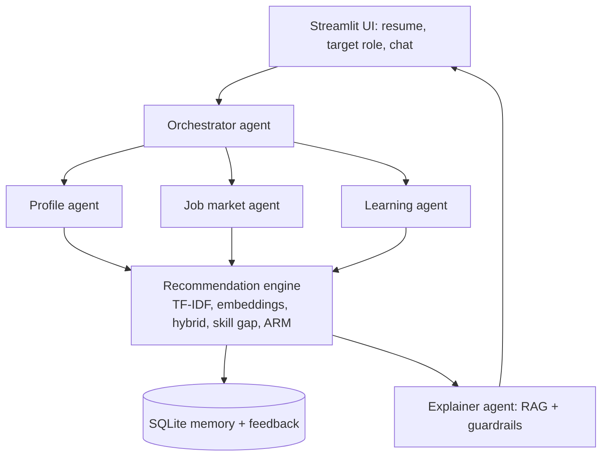

# SkillPath AI

**An agentic hybrid recommender for personalized career development. CMPE 256 (Recommender Systems) project.**

SkillPath AI reads a user's resume and career goal, then recommends:

- **Jobs** that match the user's skills
- **Skill gaps** for a target role
- **Courses** that cover those gaps
- **A learning roadmap**, explained in plain language by an AI assistant

The recommendation algorithms do the ranking. The AI agents coordinate them and explain the results. They do not replace them.

## Research question

> Does a hybrid, agentic recommender improve personalized career and learning recommendations compared to traditional content-based filtering?

We compare three models on the same test profiles using Precision@K, Recall@K, NDCG@K and F1:

| Model | Approach |
|---|---|
| 1. Traditional | TF-IDF + cosine similarity |
| 2. Semantic | Sentence embeddings + ChromaDB vector retrieval |
| 3. Agentic hybrid | Combined ranking + association rules + user feedback + agents |

## Architecture



## Getting started

Requires Python 3.10+.

```bash
git clone https://github.com/mikechau1/careerAI.git
cd careerAI
python -m venv .venv
# Windows:  .venv\Scripts\activate
# macOS/Linux:  source .venv/bin/activate
pip install -r requirements.txt
cp .env.example .env   # then add your API key
```

Download the datasets into `data/raw/` as described in [data/README.md](data/README.md).

**Run the app**

```bash
streamlit run src/skillpath/ui/app.py
```

**Run the tests**

```bash
pytest
```

## Project structure

```
careerAI/
├── data/               # datasets (git-ignored; see data/README.md)
│   ├── raw/            #   downloaded datasets
│   └── processed/      #   cleaned outputs, e.g. jobs.parquet
├── src/skillpath/
│   ├── config.py       # shared paths and settings; import from here
│   ├── recsys/         # TF-IDF, semantic, hybrid, skill gap, ARM, courses
│   ├── agents/         # LangGraph orchestrator and agents
│   └── ui/app.py       # Streamlit app
├── notebooks/          # exploration (EDA, ARM experiments)
├── eval/               # evaluation set and run_eval.py
├── docs/               # report, slides, diagrams
└── tests/
```

## Working on tasks

Tasks are on the [project board](https://github.com/users/mikechau1/projects/3). Each card has a step code such as `M2-03`:

- **M1** Setup and data
- **M2** Recommenders
- **M3** Agents and UI
- **M4** Evaluation
- **M5** Deliverables
- **M6** Stretch goals

Work in step order within each phase. Move the card to **In progress** when you start it.

**Workflow**

1. Create a branch named after the step, e.g. `m2-01-tfidf-baseline`.
2. Open a PR to `main` and put the step code in the PR title.
3. Check off the card's acceptance criteria before you merge.

**Rules**

- Never commit `.env`, datasets or uploaded resumes. `.gitignore` already excludes them.
- Take file paths from `skillpath.config` instead of hard-coding them.
